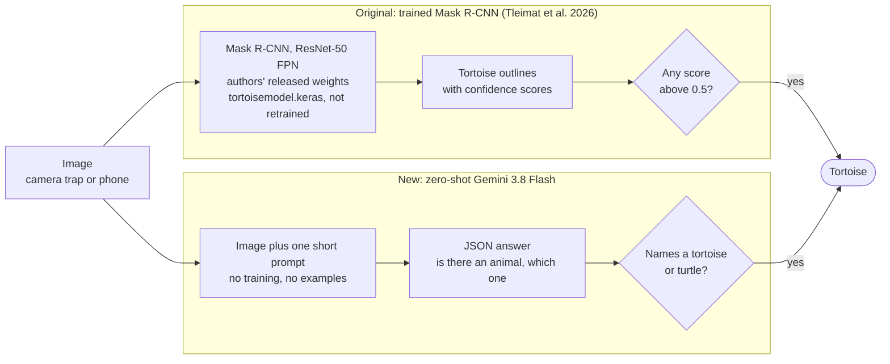
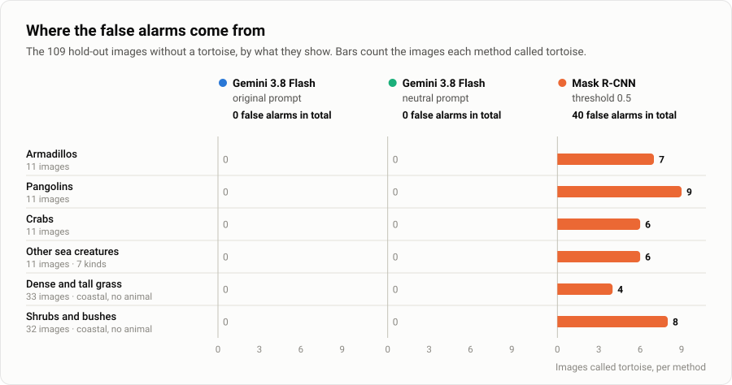
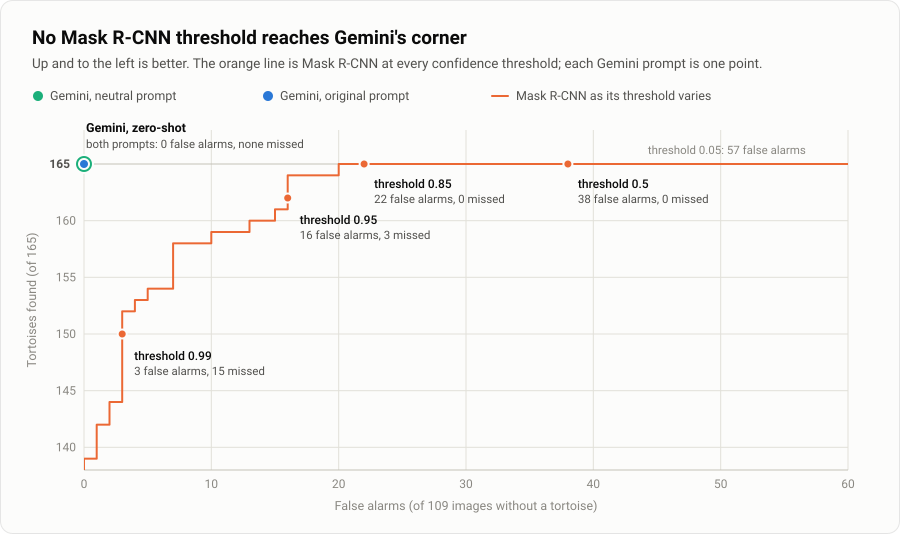
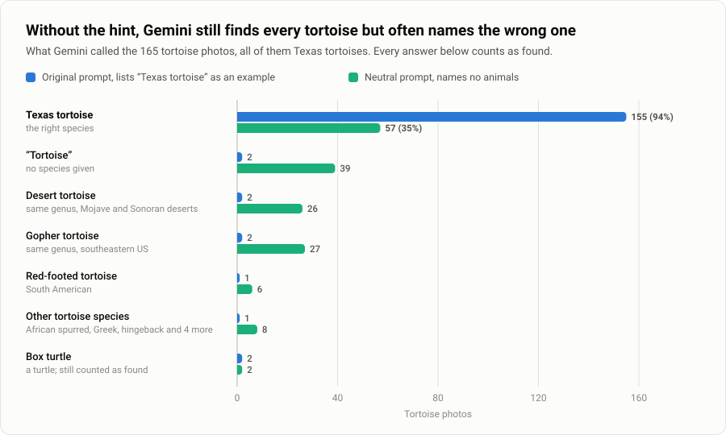

# Finding Texas tortoises in images: a trained Mask R-CNN vs. zero-shot Gemini

Texas tortoises (*Gopherus berlandieri*) hide in thick brush and are hard to survey by eye, so researchers set time-lapse camera traps that produce huge numbers of frames, almost none of which show a tortoise. [Tleimat, Krell and McCracken (2026)](#references) trained a Mask R-CNN to find tortoises in those frames and released it.

This repository asks whether a general-purpose multimodal model can do the same job **with no training at all**. It runs the released Mask R-CNN and Gemini 3.8 Flash on the same 274 hold-out images and compares the results. The hold-out set has the paper's counts: 165 tortoises, 65 photos of coastal grasses and shrubs with no animal in them, and 44 photos of animals that could pass for a tortoise.

> [!IMPORTANT]
> **Nothing is trained in this repository.** Both methods are only run, and only on the 274 hold-out images.
> - **Mask R-CNN uses Tleimat et al.'s released weights, as is.** The file is [`tleimat_original/tortoisemodel.keras`](tleimat_original/tortoisemodel.keras); despite the `.keras` name, it is a PyTorch weights file. It is loaded the same way the authors' own [`tortoise_predictor.py`](tleimat_original/tortoise_predictor.py) loads it, with no retraining or fine-tuning. The authors trained it on their own unpublished images, starting from a model pretrained on COCO (transfer learning).
> - **Gemini gets no training and no example images.**
> - **The training split in [`data/texas_tortoise_composite/train/`](data/texas_tortoise_composite/train/) is not used by either method.** It mirrors the paper's training-set counts for anyone who wants to retrain or try few-shot prompting later.

## At a glance

| | Mask R-CNN, authors' released weights | Gemini, original prompt | Gemini, neutral prompt |
|---|:---:|:---:|:---:|
| **Tortoises found** (of 165) | **165** | **165** | **165** |
| **False alarms** (of 109 images without a tortoise) | 40 at threshold 0.5<br/>22 at 0.85 | **0** | **0** |
| **Species named correctly** | does not name species | 155 (94%) | 57 (35%) |
| **Training images needed** | 2,705, every tortoise outlined by hand, used by the authors to make the weights; none used here | none | none |
| **Time for 274 images** | about 13 min, laptop CPU | about 6 min, API | about 6.5 min, API |
| **Runs offline** | yes | no | no |

All three find every tortoise. They differ in false alarms: Mask R-CNN calls more than a third of the look-alike animals and vegetation photos a tortoise, and Gemini calls none of them one. The original prompt lists example animals, Texas tortoise among them, and the neutral prompt names none. Both prompts find tortoises equally well, but without the hint Gemini names the right species far less often.

<picture>
  <source media="(prefers-color-scheme: dark)" srcset="sekharan_eval/figures/confusion-dark.svg">
  
</picture>

## The two methods



| | Original: Mask R-CNN | New: zero-shot Gemini |
|---|---|---|
| **Model** | Mask R-CNN (He et al. 2017) with a ResNet-50 (He et al. 2016) and feature-pyramid (Lin et al. 2017) backbone, pretrained on COCO (Lin et al. 2014) and fine-tuned for one class, "tortoise": transfer learning | Gemini 3.8 Flash (Google 2026), a general multimodal model, used as is |
| **What it needs** | The authors trained it on 2,705 of their own images, with every tortoise outlined by hand. Here their released weights (`tortoisemodel.keras`) are only run, not retrained | Nothing: no training and no example images |
| **Output per image** | Tortoise outlines and boxes, each with a confidence score | A JSON answer: is there an animal, and what is it |
| **Called a tortoise when** | Any detection scores above a threshold (0.5 by default) | The answer names a tortoise or turtle |
| **Runs on** | Your own computer, offline | Google's API, with an internet connection and an API key |

Gemini gets one of two prompts with each image, at temperature 0, and must answer in a fixed JSON format:

<table>
<tr><th width="50%">Original prompt</th><th width="50%">Neutral prompt</th></tr>
<tr>
<td>

```text
Look at this photograph. Is there an animal
in it?
If yes, give the animal's common name as
precisely as you can (for example: Texas
tortoise, box turtle, nine-banded armadillo,
raccoon, white-tailed deer, cattle, bird,
feral hog, coyote).
If there is no animal, answer no animal.
Return JSON only.
```

</td>
<td>

```text
Look at this photograph. Is there an animal
in it?
If yes, give the animal's common name as
precisely as you can.
If there is no animal, answer none.
Return JSON only.
```

</td>
</tr>
<tr>
<td>Answer fields: <code>animal_present</code>, <code>animal</code>, <code>is_tortoise_or_turtle</code></td>
<td>Answer fields: <code>animal_present</code>, <code>animal</code>. The tortoise call comes from the name alone.</td>
</tr>
</table>

Both prompts are kept word for word from the first runs. The original prompt's example animals were written for an earlier version of the image set; none of them is a pangolin, crab or sea creature.

## The images

The paper's images were never published. [`data/texas_tortoise_composite/`](data/texas_tortoise_composite/) rebuilds the paper's Table 1 from public photos, with the same number of tortoise, no-animal and other-animal images in each split. This comparison uses only the hold-out set:

| Class | Group | Images | Source |
|---|---|---:|---|
| **Tortoise** | Texas tortoise | **165** | iNaturalist photos, wild *Gopherus berlandieri* |
| **No animal** | Dense and tall grass: sea oats, cordgrasses, bitter panicgrass, seaside bluestem | 33 | iNaturalist, Texas coast |
| | Shrubs and bushes: sea ox-eye, marsh elder, beach croton, Christmas berry, saltwort | 32 | iNaturalist, Texas coast |
| | *All no-animal photos* | **65** | |
| **Other animal** | Armadillos, from around the study sites | 11 | iNaturalist |
| | Pangolins, from Africa and Asia | 11 | iNaturalist |
| | Crabs: blue, ghost, swimming and fiddler crabs, from Texas | 11 | iNaturalist |
| | Other sea creatures: horseshoe crabs, sea urchins, sea stars, a chiton, a whelk, a man o' war and a jellyfish | 11 | iNaturalist |
| | *All other animals* | **44** | |
| | **Total** | **274** | |

Every hold-out image is a hand-held photo, so no class can be told apart by camera type. The other animals were chosen because they have a hard shell or a domed back. The no-animal photos are stands of the coastal grasses and shrubs a tortoise could hide in, with no equipment, buildings or other man-made objects in frame.

Every image was looked at before either model ran. A no-animal photo had to show a stand of grass or a shrub, not a close-up of one flower, and no animal at all: no insects, snails, birds, people or hands. It also had to show no equipment: no vehicles, tools, fences, posts, boardwalks, buildings or survey frames. An animal photo had to show the animal itself, not a burrow, a carcass or a bleached skeleton. Each image that broke a rule was replaced by the next one in a fixed random order. [`build_holdout.py`](data/texas_tortoise_composite/build_holdout.py) lists all 105 rejected images with the reason for each.

Four images were replaced after the first runs, and all three methods then scored the replacements:
- **A worn, empty whelk shell** in the sea-creature group. The original prompt answered "none".
- **Three vegetation photos with a small animal in them.** The neutral prompt named a dragonfly, a snail and a butterfly. On a closer look the dragonfly is on a leaf, the snail is probably a small dark round object on the mud, and the butterfly may be orange shapes in the leaves.

None of these was a tortoise call, so Gemini's results did not change. To keep the check even-handed, every vegetation photo Mask R-CNN called a tortoise got the same second look; none hid an animal.

No iNaturalist photographer has images in both splits. **Neither method uses the training split.** It has the paper's counts for model M4 (1,332 / 420 / 953). Its tortoises are iNaturalist photos, and most of its other images are trail-camera frames. It is there for anyone who wants to retrain the detector or try few-shot prompting. See [the data README](data/texas_tortoise_composite/README.md) for every source, rule and licence.

## Results

| Method | Found | Missed | False alarms | Precision | Recall | F1 | Accuracy | False-alarm rate (95% CI) |
|---|---:|---:|---:|---:|---:|---:|---:|---|
| **Gemini 3.8 Flash, neutral prompt** | **165** | **0** | **0** | **1.000** | **1.000** | **1.000** | **1.000** | **0.0%** (0.0–3.3%) |
| **Gemini 3.8 Flash, original prompt** | **165** | **0** | **0** | **1.000** | **1.000** | **1.000** | **1.000** | **0.0%** (0.0–3.3%) |
| Mask R-CNN, threshold 0.5 (paper's default) | 165 | 0 | 40 | 0.805 | 1.000 | 0.892 | 0.854 | 36.7% (27.7–46.5%) |
| Mask R-CNN, threshold 0.85 (paper's best F1) | 165 | 0 | 22 | 0.882 | 1.000 | 0.938 | 0.920 | 20.2% (13.1–28.9%) |
| Mask R-CNN, threshold 0.95 | 162 | 3 | 14 | 0.920 | 0.982 | 0.950 | 0.938 | 12.8% (7.2–20.6%) |

Intervals are exact Clopper–Pearson intervals (Clopper and Pearson 1934). On the 109 images without a tortoise, Mask R-CNN at 0.5 flagged 40 that Gemini did not, and Gemini flagged none that Mask R-CNN did not. The gap is far beyond chance: exact McNemar test (McNemar 1947), p < 10⁻¹¹ for either prompt.

For context, the paper (Tleimat et al. 2026) reports this same model on its own trail-camera hold-out set, at threshold 0.5 and counting each tortoise whose box overlaps the drawn outline: precision 0.93, recall 0.83, accuracy 0.86, false-positive rate 0.09 and F1 0.88 (Table 3). Recall is higher here because every tortoise is a clear hand-held photo. The false-positive rate is higher because these negatives were picked to look like tortoises, while the paper's were frames from its own cameras. See [Limits](#limits).

### Where the false alarms come from

<picture>
  <source media="(prefers-color-scheme: dark)" srcset="sekharan_eval/figures/false-alarms-dark.svg">
  
</picture>

- **Armour-backed animals:** Mask R-CNN called 9 of the 11 pangolins and 7 of the 11 armadillos a tortoise, the two groups that look most like one.
- **Crabs and sea creatures:** it also called 6 crabs and 6 other sea creatures a tortoise: two horseshoe crabs, a chiton, the whelk, a jellyfish and a man o' war.
- **Vegetation:** 12 of the 65 photos with no animal at all were flagged: 4 of the grass photos and 8 of the shrubs.
- **Gemini:** neither prompt called any of the 109 a tortoise. Both named every armadillo "nine-banded armadillo", every pangolin a pangolin and every crab a crab. They also named each sea creature, from "horseshoe crab" to "Portuguese man o' war", and answered "none" for every vegetation photo.

### Raising the threshold does not close the gap

<picture>
  <source media="(prefers-color-scheme: dark)" srcset="sekharan_eval/figures/tradeoff-dark.svg">
  
</picture>

Mask R-CNN ranks images fairly well (ROC AUC 0.991). Its trouble is confident mistakes:
- Every real tortoise scores at least 0.885, but 18 of the images without a tortoise score higher than that.
- The highest, a pangolin at 0.995, outscores 26 of the tortoises.
- At the strictest threshold that still finds every tortoise, it raises 18 false alarms.
- Getting to zero false alarms costs 26 tortoises.

Gemini, with either prompt, sits in the top-left corner, where no point on the Mask R-CNN curve reaches.

### Does the prompt matter?

<picture>
  <source media="(prefers-color-scheme: dark)" srcset="sekharan_eval/figures/species-dark.svg">
  
</picture>

For finding tortoises, no: both prompts found all 165 and raised no false alarms.

For naming the species, yes:

| What Gemini called the 165 Texas tortoises | Original prompt | Neutral prompt |
|---|---:|---:|
| Texas tortoise, the right species | **155** (94%) | 57 (35%) |
| "Tortoise", with no species | 2 | 39 |
| Desert or gopher tortoise, the two other North American *Gopherus* species | 4 | 53 |
| Species from other continents (red-footed, African spurred, Greek, hingeback and others) | 2 | 14 |
| Box turtle | 2 | 2 |

Asked a yes-or-no tortoise question, Gemini does not need the hint. To name the species without it, the model probably needs other context, such as where the photo was taken; that is untested. The scoring here counts any tortoise or turtle answer as a hit. Box turtles also live in South Texas, so a real survey would need to treat "turtle" answers differently.

### Speed and cost

| | Mask R-CNN | Gemini, original prompt | Gemini, neutral prompt |
|---|---|---|---|
| **Where it ran** | Laptop CPU (Intel Core i7-1255U), PyTorch (Ansel et al. 2024) and TorchVision, offline | Gemini API | Gemini API |
| **Time per image** (median) | 2.9 s | 4.8 s per request | 4.8 s per request |
| **All 274 images** | about 13 min of compute | about 6 min, 4 requests at a time | about 6.5 min, 4 requests at a time |
| **Tokens per image** | none | about 1,400 | about 1,450 |

The three runs shared one laptop and one network connection at the same time, so the times are rough. The token counts come from the first full runs with the same prompts, on the earlier version of the image set. The scripts record usage per run, and the last runs only scored the three replaced images. A GPU would make Mask R-CNN much faster; that was not measured here.

## Limits

- **No trail-camera tortoises.** Every image here is a hand-held photo, and most tortoises are clear close-ups. Real survey frames are trail-camera pictures, and their hard cases are untested for both methods: tortoises far away, partly hidden or cut off at the frame edge.
- **Hard negatives, by design.** The other animals were chosen to look like a tortoise and the vegetation is the kind it hides in, so Mask R-CNN's false-alarm rate here is far above the paper's. Neither number is the rate a real survey would see.
- **Label checks are by eye.** I looked at every image, and at the no-animal photos again at a larger size, and still missed a dragonfly and probably a snail that Gemini found. A few small mistakes may remain.
- **Possible prior exposure.** The paper drew some of its training tortoises from iNaturalist, and Gemini was trained on web data, so either model may have seen some of these photos before.
- **Small negative set.** With 109 non-tortoise images, zero false alarms is consistent with a true rate of up to 3.3%.
- **Per-image scoring.** An image counts as found if the method flags it anywhere. The paper's rule also requires the predicted box to overlap the drawn tortoise.

## Next steps

- Test both methods on real trail-camera tortoise frames, for example the authors' own.
- Add location to the neutral prompt (for example "taken in South Texas") and see whether species names recover without listing any species.
- Try few-shot prompts that use images from the training split.
- Try a cascade: Mask R-CNN screens every frame cheaply and offline, then Gemini checks only the frames it flags.

## Reproduce

```bash
git lfs install                    # the Mask R-CNN weights are stored with Git LFS
git clone https://github.com/csekharan/tortoise-predictor.git
cd tortoise-predictor/sekharan_eval
pip install -r requirements.txt    # torch, torchvision, pillow (CPU builds are enough)

python eval_maskrcnn.py                      # Mask R-CNN on the 274 hold-out images
export GEMINI_API_KEY=...                    # PowerShell: $env:GEMINI_API_KEY="..."
python zero_shot_gemini.py                   # Gemini, original prompt
python zero_shot_gemini.py --prompt neutral  # Gemini, neutral prompt
python compare_models.py                     # breakdown by image type
python make_figures.py                       # redraws the figures and prints the numbers above
```

Both scorers save as they go and resume where they stopped. See [`sekharan_eval/README.md`](sekharan_eval/README.md) for all options. The images are in the repository; `data/texas_tortoise_composite/build_holdout.py` rebuilds the hold-out set from its sources.

## Repository layout

```text
tortoise-predictor/
├── tleimat_original/            original detector code, weights and licence, unchanged
├── sekharan_eval/               this comparison; imports nothing from tleimat_original
│   ├── zero_shot_gemini.py      Gemini scorer, both prompts (standard library only)
│   ├── eval_maskrcnn.py         runs tleimat_original/tortoisemodel.keras on the same images
│   ├── compare_models.py        joins the prediction files
│   ├── make_figures.py          draws the figures in this README
│   ├── results/                 per-image predictions and metrics for every run
│   └── figures/
└── data/
    └── texas_tortoise_composite/   2,979 images, manifest.csv, build scripts; read by both
```

## Credits and licences

- **Original detector:** code and weights from [github.com/jtleimat/tortoise-predictor](https://github.com/jtleimat/tortoise-predictor) (Tleimat et al. 2026), MIT licence ([`tleimat_original/LICENSE`](tleimat_original/LICENSE)).
- **Images:** each image keeps its own licence. `manifest.csv` gives the licence, credit line and source page for every image.
  - iNaturalist photos are under their photographers' Creative Commons licences. Most are non-commercial, so the image set as a whole is for research use.
  - Training-set trail-camera frames: NACTI (Tabak et al. 2019), via LILA BC under the CDLA-Permissive-1.0 licence, and the South Texas sample of Kutugata et al. (2021), MIT licence.

  See [`data/texas_tortoise_composite/README.md`](data/texas_tortoise_composite/README.md) for details.

## References

- Ansel J, Yang E, He H, Gimelshein N, Jain A, Voznesensky M, Bao B, Bell P, Berard D, Burovski E, Chauhan G, et al. 2024. PyTorch 2: faster machine learning through dynamic Python bytecode transformation and graph compilation. Pp. 929–947 In: *Proceedings of the 29th ACM International Conference on Architectural Support for Programming Languages and Operating Systems (ASPLOS '24), Volume 2*. Association for Computing Machinery, New York.
- Clopper CJ, Pearson ES. 1934. The use of confidence or fiducial limits illustrated in the case of the binomial. *Biometrika* 26(4): 404–413.
- Google. 2026. Gemini 3.8 Flash, used through the Gemini API (`generativelanguage.googleapis.com`), November 2026. [ai.google.dev](https://ai.google.dev/).
- He K, Gkioxari G, Dollár P, Girshick R. 2017. Mask R-CNN. Pp. 2961–2969 In: *Proceedings of the IEEE International Conference on Computer Vision (ICCV)*, Venice. IEEE.
- He K, Zhang X, Ren S, Sun J. 2016. Deep residual learning for image recognition. Pp. 770–778 In: *Proceedings of the IEEE Conference on Computer Vision and Pattern Recognition (CVPR)*, Las Vegas. IEEE.
- iNaturalist. Observations of *Gopherus berlandieri*, coastal plants, armadillos, pangolins, crabs and sea creatures. [www.inaturalist.org](https://www.inaturalist.org), accessed November 2026.
- Kutugata M, Baumgardt J, Goolsby JA, Racelis AE. 2021. Automatic camera-trap classification using wildlife-specific deep learning in nilgai management. *Journal of Fish and Wildlife Management* 12(2): 412–421. Images from [github.com/mkutu/Nilgai](https://github.com/mkutu/Nilgai).
- Lin TY, Dollár P, Girshick R, He K, Hariharan B, Belongie S. 2017. Feature pyramid networks for object detection. Pp. 2117–2125 In: *Proceedings of the IEEE Conference on Computer Vision and Pattern Recognition (CVPR)*, Honolulu. IEEE.
- Lin TY, Maire M, Belongie S, Hays J, Perona P, Ramanan D, Dollár P, Zitnick CL. 2014. Microsoft COCO: common objects in context. Pp. 740–755 In: *Computer Vision – ECCV 2014, 13th European Conference*, Zurich. Springer.
- McNemar Q. 1947. Note on the sampling error of the difference between correlated proportions or percentages. *Psychometrika* 12(2): 153–157.
- Tabak MA, Norouzzadeh MS, Wolfson DW, Sweeney SJ, VerCauteren KC, Snow NP, et al. 2019. Machine learning to classify animal species in camera trap images: applications in ecology. *Methods in Ecology and Evolution* 10(4): 585–590. Images (NACTI) from [lila.science/datasets/nacti](https://lila.science/datasets/nacti/).
- Tleimat JM, Krell E, McCracken SF. 2026. Needle in a haystack: towards the use of machine learning to detect Texas tortoises in large datasets. *Amphibian & Reptile Conservation* 20(1): 67–81 (e356).
- TorchVision maintainers and contributors. 2016. TorchVision: PyTorch's computer vision library. [github.com/pytorch/vision](https://github.com/pytorch/vision).
