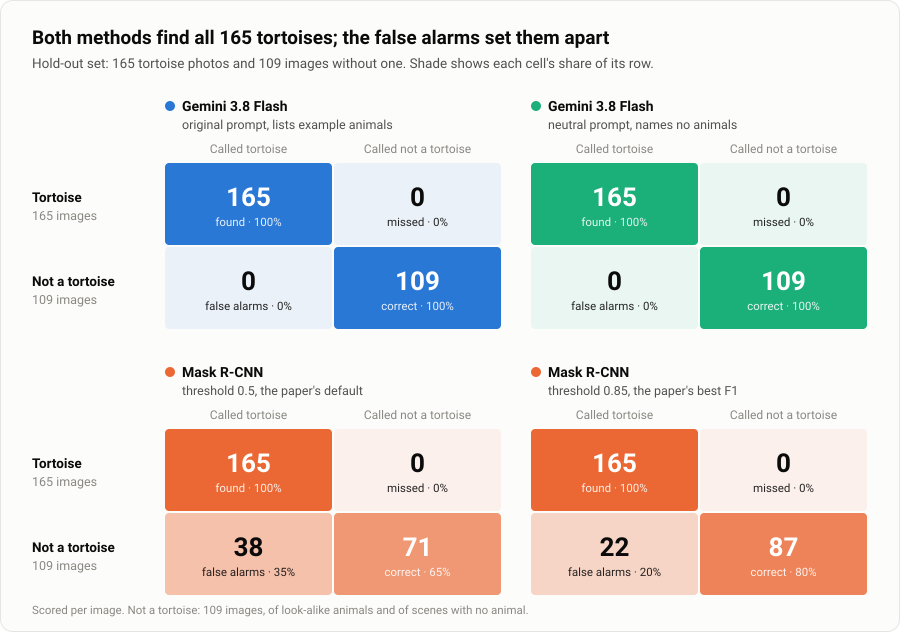
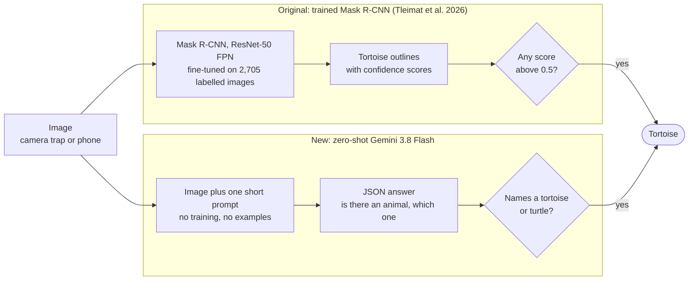

# Finding Texas tortoises in images: a trained Mask R-CNN vs. zero-shot Gemini

Texas tortoises (*Gopherus berlandieri*) hide in thick brush and are hard to survey by eye, so researchers set time-lapse camera traps that produce huge numbers of frames, almost none of which show a tortoise. Tleimat, Krell and McCracken (2026) trained a Mask R-CNN to find tortoises in those frames and released it.

This repository asks whether a general-purpose multimodal model can do the same job **with no training at all**. It runs the released Mask R-CNN and Gemini 3.8 Flash on the same 274 hold-out images and compares the results.

**In short:** both find all 164 tortoises. The trained model also calls 18 of the 110 non-tortoise images a tortoise, while Gemini calls 1.

<picture>
  <source media="(prefers-color-scheme: dark)" srcset="sekharan_eval/figures/confusion-dark.svg">
  
</picture>

## The two methods



| | Original: Mask R-CNN | New: zero-shot Gemini |
|---|---|---|
| Model | Mask R-CNN with a ResNet-50 FPN backbone, pretrained on COCO and fine-tuned for one class, "tortoise" | Gemini 3.8 Flash, a general multimodal model, used as is |
| What it needs | 2,705 training images with every tortoise outlined by hand | Nothing: no training and no example images |
| Output per image | Tortoise outlines and boxes, each with a confidence score | A JSON answer: is there an animal, what is it, is it a tortoise or turtle |
| Called a tortoise when | Any detection scores above a threshold (0.5 by default) | The answer names a tortoise or turtle |
| Runs on | Your own computer, offline | Google's API, with an internet connection and an API key |
| Time for 274 images | 14 min on a laptop CPU, 3.0 s per image | 5.6 min with 4 requests at a time, 4.0 s per request |

Gemini gets this prompt with each image, at temperature 0, and must reply in a fixed JSON format:

```text
Look at this photograph. Is there an animal in it?
If yes, give the animal's common name as precisely as you can (for example: Texas tortoise,
box turtle, nine-banded armadillo, raccoon, white-tailed deer, cattle, bird, feral hog, coyote).
If there is no animal, answer no animal.
Return JSON only.
```

The example names could steer the model toward "tortoise". A second, neutral prompt names no animals and does not ask about tortoises (`--prompt neutral`). Its run is still to do.

## The images

The paper's images were never published. [`data/texas_tortoise_composite/`](data/texas_tortoise_composite/) rebuilds the paper's Table 1 from public sources, with the same number of tortoise, empty and other-animal images in each split:

| Split | Tortoise | Empty frame | Other animal | Total |
|---|---:|---:|---:|---:|
| Training | 1,332 | 420 | 953 | 2,705 |
| Hold-out | 165 | 65 | 44 | 274 |

- **Tortoises:** research-grade iNaturalist photos.
- **Empty frames and most other animals:** trail-camera frames, from NACTI's Florida cameras and from the South Texas sample published with a nilgai detection study.
- **Armadillos:** weighted heavily, as in the paper, because they look most like tortoises.

No iNaturalist photographer and no NACTI camera appears in both splits. This comparison uses only the hold-out images. The training split is there for anyone who wants to retrain the detector or try few-shot prompting.

One hold-out photo labeled tortoise (`inat-tortoise_inat50015197_p79414426.jpg`) shows a bulldozer and a pickup truck and no tortoise. The results below count it as not a tortoise, which leaves 164 tortoise images and 110 others.

## Results

| Method | Found | Missed | False alarms | Precision | Recall | F1 | Accuracy | False-alarm rate (95% CI) |
|---|---:|---:|---:|---:|---:|---:|---:|---|
| **Gemini 3.8 Flash, zero-shot** | 164 | 0 | **1** | **0.994** | 1.000 | **0.997** | **0.996** | **0.9%** (0.0–5.0%) |
| Mask R-CNN, threshold 0.5 (paper's default) | 164 | 0 | 18 | 0.901 | 1.000 | 0.948 | 0.934 | 16.4% (10.0–24.6%) |
| Mask R-CNN, threshold 0.85 (paper's best F1) | 164 | 0 | 7 | 0.959 | 1.000 | 0.979 | 0.974 | 6.4% (2.6–12.7%) |
| Mask R-CNN, threshold 0.95 | 161 | 3 | 4 | 0.976 | 0.982 | 0.979 | 0.974 | 3.6% (1.0–9.0%) |

Intervals are exact Clopper–Pearson intervals. The two models made their false alarms on different images: 18 that only Mask R-CNN flagged and 1 that only Gemini flagged. That difference is unlikely to be chance (exact McNemar test, p < 0.001).

For context, the paper reports this same model on its own trail-camera hold-out set, at threshold 0.5 and counting each tortoise whose box overlaps the drawn outline: precision 0.93, recall 0.83, accuracy 0.86, false-positive rate 0.09 and F1 0.88 (Table 3). Recall is much higher here because every tortoise in this hold-out set is a clear hand-held photo; see [Limits](#limits).

### Where the false alarms come from

<picture>
  <source media="(prefers-color-scheme: dark)" srcset="sekharan_eval/figures/false-alarms-dark.svg">
  
</picture>

- **Armadillos:** they account for a third of Mask R-CNN's false alarms. Gemini called none of the 16 a tortoise: it named 13 as nine-banded armadillos and saw no animal in the other 3.
- **Other animals:** Mask R-CNN also flagged every feral hog and wild turkey in the set.
- **Gemini's one error:** it called an empty South Texas trail-camera frame "Texas tortoise".
- **Empty Florida frames:** neither model flagged any of the 44.

### Raising the threshold does not close the gap

<picture>
  <source media="(prefers-color-scheme: dark)" srcset="sekharan_eval/figures/tradeoff-dark.svg">
  
</picture>

Mask R-CNN ranks images well (ROC AUC 0.997). Its trouble is a handful of confident mistakes:
- Every real tortoise scores at least 0.885, but six non-tortoise images score higher than that. The highest, an armadillo at 0.99, outscores 14 of the tortoises.
- At its best setting with no missed tortoises, it still raises 6 false alarms.
- Getting to zero false alarms costs 14 tortoises.

Gemini's single result sits above and to the left of every point on that curve.

### Speed and cost

| | Mask R-CNN | Gemini 3.8 Flash |
|---|---|---|
| Where it ran | Laptop CPU (Intel Core i7-1255U), PyTorch, offline | Gemini API |
| Time per image | 3.0 s (median) | 4.0 s per request (median); 1.2 s per image with 4 requests in parallel |
| All 274 images | 14 min 14 s | 5 min 34 s |
| Tokens | none | about 1,400 per image: 1,160 in, 30 out, 230 thinking |

A GPU would make Mask R-CNN much faster; that was not measured here. Gemini's time depends on the network and on how many requests run at once.

## Limits

- **No trail-camera tortoises.** Every tortoise here is a hand-held photo, often a close-up, while the empty frames and most other animals are trail-camera frames. Hard cases from real deployments are untested for both models: tortoises far away, partly hidden or cut off at the frame edge. Both models could also partly be telling phone photos from camera frames.
- **Possible prior exposure.** The paper drew some of its training tortoises from iNaturalist, and Gemini was trained on web data, so either model may have seen some of these photos before.
- **Small negative set.** With 110 non-tortoise images, Gemini's 1 false alarm is consistent with a true rate anywhere up to about 5%.
- **Per-image scoring.** An image counts as found if the model flags it anywhere. The paper's rule also requires the predicted box to overlap the drawn tortoise.
- **Prompt priming.** The prompt above names tortoises and armadillos as examples. The neutral prompt run will show how much that matters.

## Next steps

- Run the neutral prompt (`python zero_shot_gemini.py --prompt neutral`).
- Test both models on real trail-camera tortoise frames, for example the authors' own.
- Try few-shot prompts that use images from the training split.
- Try a cascade: Mask R-CNN screens every frame cheaply and offline, then Gemini checks only the frames it flags.

## Reproduce

```bash
git lfs install                    # the Mask R-CNN weights are stored with Git LFS
git clone https://github.com/csekharan/tortoise-predictor.git
cd tortoise-predictor/sekharan_eval
pip install -r requirements.txt    # torch, torchvision, pillow (CPU builds are enough)

python eval_maskrcnn.py            # Mask R-CNN on the 274 hold-out images
export GEMINI_API_KEY=...          # PowerShell: $env:GEMINI_API_KEY="..."
python zero_shot_gemini.py         # Gemini, original prompt
python compare_models.py           # breakdown by image type
python make_figures.py             # redraws the figures and prints the numbers above
```

Both scorers save as they go and resume where they stopped. See [`sekharan_eval/README.md`](sekharan_eval/README.md) for all options.

## Repository layout

```text
tortoise-predictor/
├── tleimat_original/            original detector code, weights and licence, unchanged
├── sekharan_eval/               this comparison; imports nothing from tleimat_original
│   ├── zero_shot_gemini.py      Gemini scorer (standard library only)
│   ├── eval_maskrcnn.py         runs tleimat_original/tortoisemodel.keras on the same images
│   ├── compare_models.py        joins the two prediction files
│   ├── make_figures.py          draws the figures in this README
│   ├── results/                 per-image predictions and metrics for both models
│   └── figures/
└── data/
    └── texas_tortoise_composite/   2,979 images, manifest.csv, build scripts; read by both
```

## Credits and licences

- **Original detector:** Tleimat JM, Krell E, McCracken SF. 2026. Needle in a haystack: towards the use of machine learning to detect Texas tortoises in large datasets. *Amphibian & Reptile Conservation* 20(1): 67–81 (e356). Code and weights from [github.com/jtleimat/tortoise-predictor](https://github.com/jtleimat/tortoise-predictor), MIT licence ([`tleimat_original/LICENSE`](tleimat_original/LICENSE)).
- **Images:** each image keeps its own licence. `manifest.csv` gives the licence, credit line and source page for every image.
  - iNaturalist photos are under their photographers' Creative Commons licences. About half are non-commercial, so the image set as a whole is for research use.
  - NACTI frames: Tabak MA et al. 2019, *Methods in Ecology and Evolution* 10(4): 585–590, via LILA BC, under the CDLA-Permissive-1.0 licence.
  - South Texas frames: Kutugata M et al. 2021, *Journal of Fish and Wildlife Management* 12(2): 412–421, MIT licence.

  See [`data/texas_tortoise_composite/README.md`](data/texas_tortoise_composite/README.md) for details.
